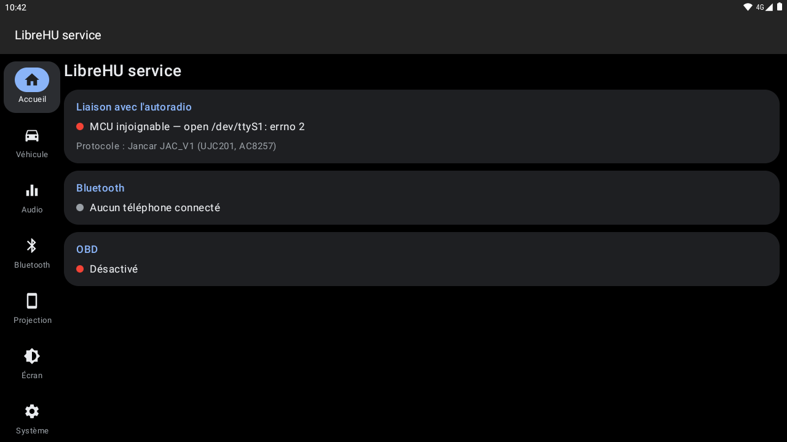
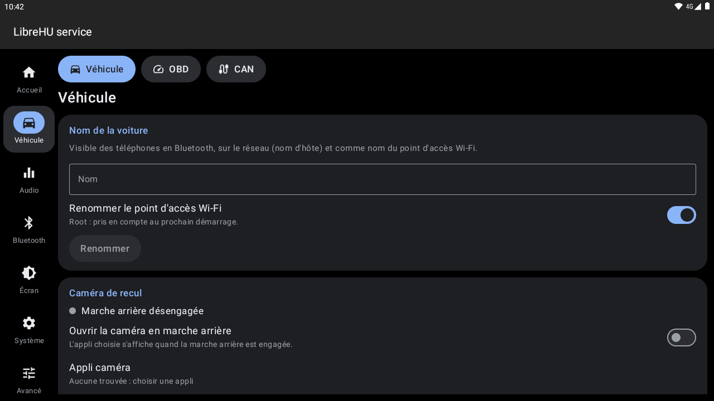
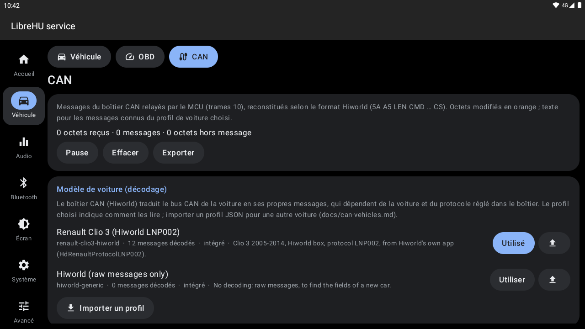
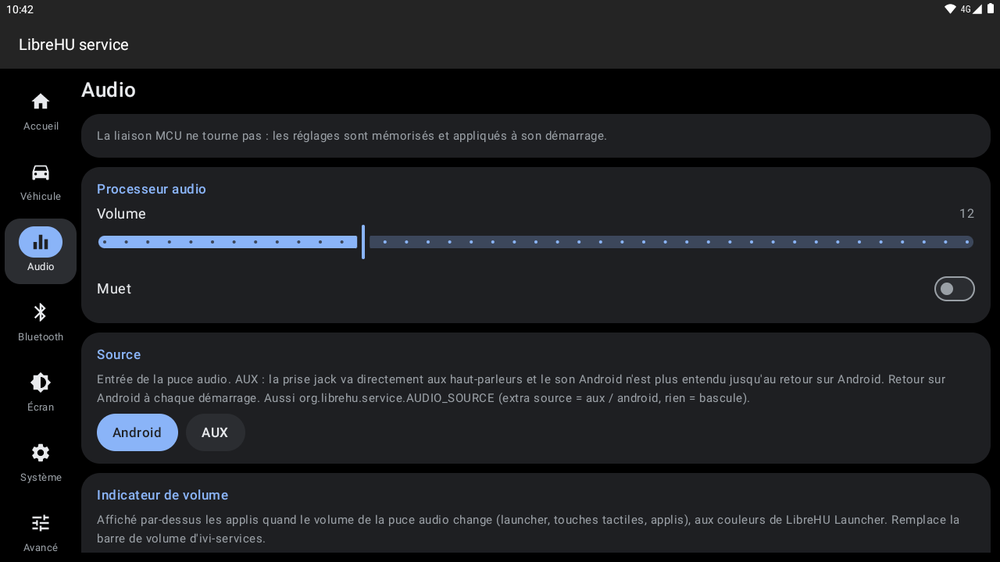
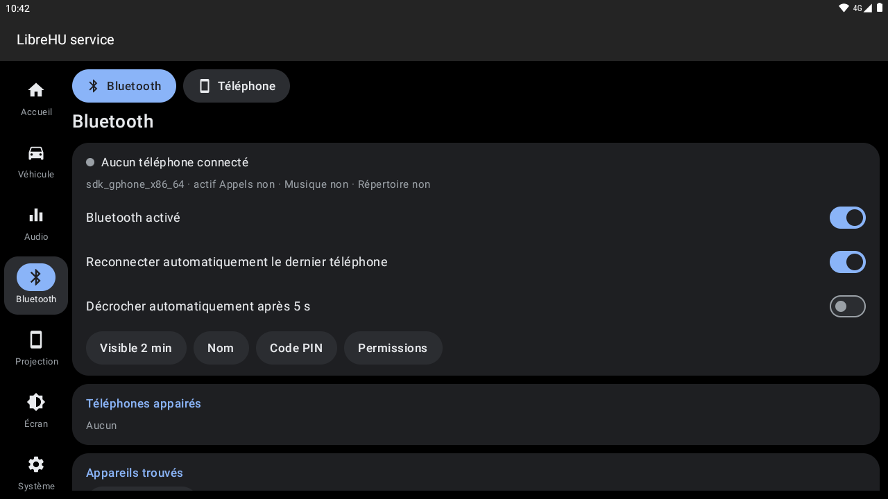
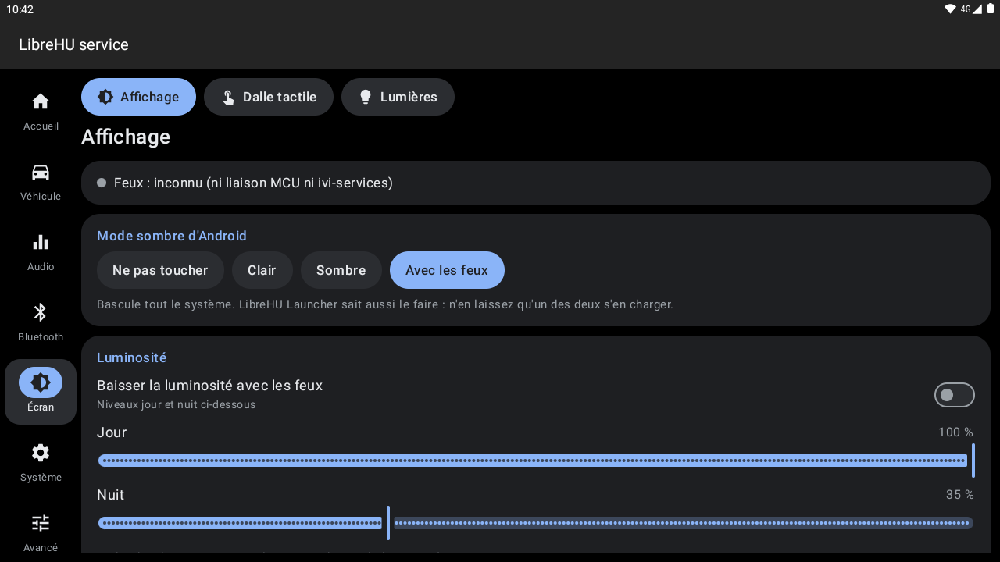
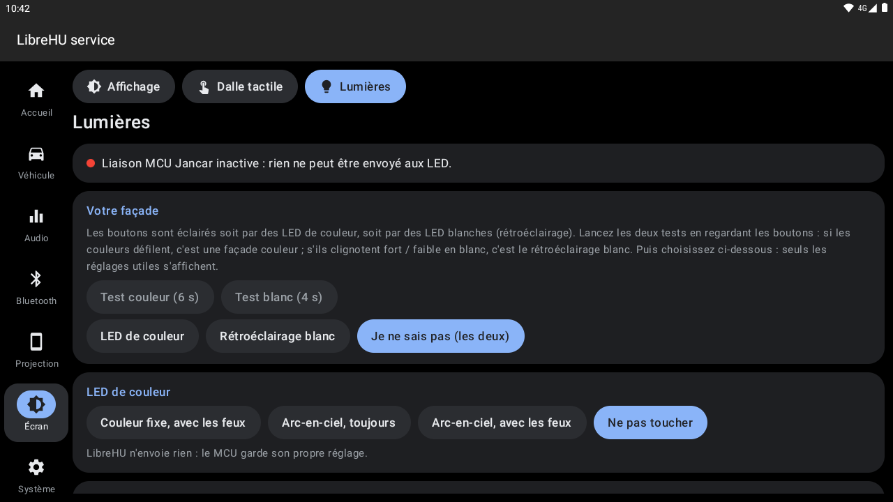
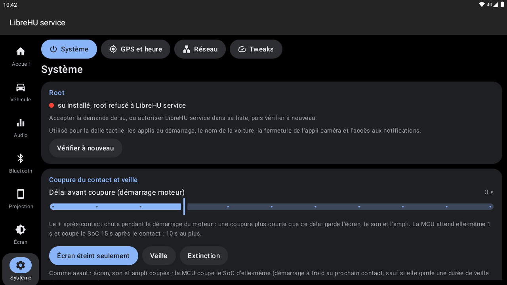
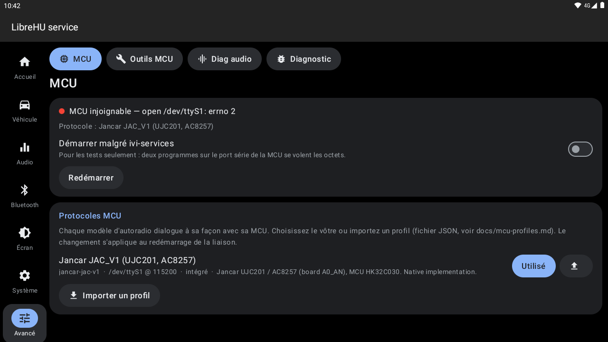
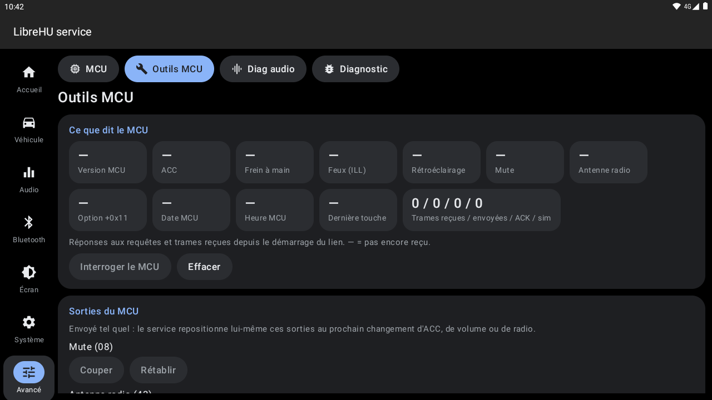

# LibreHU-service

Service libre de gestion des autoradios Jancar / Autochips AC8257 (UJC201) : MCU, alimentation, puce audio,
radio, touches, caméra. Il vise à remplacer `com.jancar.services` (ivi-services) et à exposer une API propre
aux apps LibreHU (MCU Toolkit, fork ViPER4Android, radio, caméra…).

État : **premières bases (v0, non testée sur l'appareil)**. Le protocole MCU et le pilote audio sont couverts par
des tests unitaires ; le comportement réel sur l'UJC201 reste à valider.

## Captures d'écran

| | |
|---|---|
| <br>Accueil | <br>Véhicule : nom, caméra de recul |
| <br>Trames CAN | <br>Audio |
| <br>Bluetooth | <br>Écran |
| <br>Lumières (LED) | <br>Système |
| <br>Avancé : MCU | <br>Outils MCU |

Captures sur l'émulateur Android 11 (1280×720, 160 dpi comme l'autoradio), sans autoradio branché : les valeurs du véhicule et de la MCU sont vides. Refaites-les avec l'action **Screenshots** de [LibreHU-OTA-app](https://github.com/LibreHU/LibreHU-OTA-app/tree/main/screenshots).

## Ce qui est implémenté

| Module | Contenu | Où |
|---|---|---|
| Transport MCU | trame `JAC_V1` (`EE FA LEN CMD DATA CS`), ACK `C0`, renvoi 500 ms × 5 pour `1F 08 01 F1 80`, trames longues (CAN, LEN ≥ 0x80) | `core/.../mcu` |
| Véhicule | ACC, frein à main, feux, version MCU (trames MCU) ; marche arrière et clignotants (GPIO 2 / 7 / 6, actifs bas ; clignotants filtrés comme ivi-services, entrée bloquée à 0 sans clignoter = non branchée, désactivables) | `core/.../unit/HeadUnit.kt` |
| Alimentation | `1F 01` au démarrage ; ACC on : démute (MCU `08 00`, GPIO 166, puce), rétroéclairage GPIO 5 après 800 ms, ampli externe `44` ; ACC off : mute, rétroéclairage coupé, `44 00` | idem |
| Horloge | heure Android réglée depuis la RTC de la MCU une fois par démarrage (si `SET_TIME`), puis heure Android envoyée à la MCU chaque minute ; heure GPS périodique (15 min à 12 h, activée par défaut) ; chaque sens activable, synchro manuelle. Voir [docs/gps-time.md](docs/gps-time.md) | `HeadUnit.kt`, `time/TimeController.kt` |
| Audio | pilote **ROHM BD37534** (I2C 6 @0x40) : séquence d'init de Jancar, source Android ou **AUX** (entrée 0, +5 dB ; onglet Audio, API 6, intent `org.librehu.service.AUDIO_SOURCE`) ; pendant l'AUX, le son d'Android ajouté par l'entrée de mixage de la puce comme le fait ivi-services (mono, niveau suivant le volume, réglable), volume (courbe 0..40), mute doux, graves/médiums/aigus, balance/fader 4 voies, loudness, caisson on/off + niveau ; réglages mémorisés | `core/.../audio/Bd37534.kt` |
| Android Auto | pilotage d'[Open Headunit](https://github.com/andreknieriem/headunit-revived) ou de son fork LibreHU (`org.librehu.headunit`) par son interface d'automatisation : état de la session (aussi sur le launcher), ouvrir / chercher le téléphone en USB / déconnecter / relancer le son, **jour / nuit selon les phares**, **ses réglages modifiables depuis LibreHU-service** (fork : sans interrupteur, par signature) ; avec le fork : **infos de la voiture** (frein à main, vitesse, régime, carburant, phares…) envoyées au téléphone, **touches volant** vers Android Auto (Assistant vocal compris), retour à la projection après la caméra de recul, export du journal. Voir [docs/android-auto.md](docs/android-auto.md) | `projection/AndroidAuto.kt`, onglet Android Auto |
| Téléphone | page Bluetooth → Téléphone et widget : téléphone Bluetooth (nom, batterie en 5 paliers, signal, opérateur) et **iPhone** par l'appli CarPlay LibreHU (nom, modèle, iOS, batterie, charge, **cycles, température, capacités, tension, courant** lus par Lockdown et les diagnostics d'iOS en CarPlay filaire ; en sans fil : nom, modèle, batterie, charge ; dernier relevé gardé) ; **iPhone branché : Bluetooth activé et appairage demandé** ; **pendant CarPlay filaire, mains libres et musique Bluetooth de l'iPhone coupés** (CarPlay a les appels et le son) — voir [docs/phone.md](docs/phone.md) | `phone/PhoneInfo.kt`, `phone/PhoneWidget.kt`, Bluetooth → Téléphone |
| CarPlay | [xcertplay](https://github.com/shilapi/xcertplay) en fork LibreHU (`org.librehu.carplay`) : état de la session (diffusion `org.librehu.carplay.SESSION_STATE`), ouvrir, **jour / nuit selon les phares** envoyé à l'iPhone (`SET_NIGHT_MODE`, permission signature du fork), **ouverture au branchement de l'iPhone** (appareil USB Apple `05ac` : l'appli ne se connecte que son écran ouvert, une fois par branchement, pas pendant une session) ; l'appli suit aussi le thème et l'accent du launcher. Onglet Projection → CarPlay | `projection/CarPlay.kt`, Projection → CarPlay |
| Tweaks | réglages du noyau façon SmartPack Kernel (root) : par groupe de cœurs, gouverneur (interactive, ondemand, conservative, schedutil, powersave, userspace du noyau stock) et fréquences min / max ; GPU PowerVR gardé sur un palier MediaTek (`/proc/gpufreq`, 390 / 500 / 660 MHz selon la puce, pas de surcadençage) ou automatique ; ordonnanceur d'E/S et lecture anticipée de l'eMMC ; swappiness (zram) ; contrôle de congestion TCP ; températures. Appliqués tout de suite, et au démarrage si demandé, avec protection contre une boucle de redémarrage (90 s) ; retour aux valeurs d'origine | `tweaks/Tweaks.kt`, Système → Tweaks |
| Microphone | réglages usine de Jancar sans ivi-settings : **gain matériel** 1 / 2 / 3 (`MIC1_HW_GAIN` / `MIC2_HW_GAIN` = 3 / 4 / 5 du HAL audio, réappliqué à chaque démarrage, gardé dans `persist.jancar.mic.hw.gain` avec root) et **ECNR** (annulation d'écho / réduction de bruit, `persist.audiohal.third_ecnr_lib.enable` / `vendor.…`, root) ; « ROM » laisse la valeur en place. Voir `docs/projection_stock.md` du dépôt device | `Microphone.kt`, onglet Audio |
| Réseau filaire (USB) | onglet Système → Réseau : adaptateurs Ethernet USB et téléphones branchés (puce reconnue, pilote lié ou manquant), interfaces `eth*` / `usb*` (MAC, débit, IPv4), réseau Ethernet d'Android et accès Internet ; pilotes du zip flashable **usb-net** (Realtek RTL8152 / RTL8153, partage de connexion USB Android et iPhone, LAN78xx, SMSC, DM9601, SR9700 / SR9800, MCS7830, CH9200, RTL8150, Pegasus, CDC EEM) : état, chargement immédiat, désactivation au démarrage (protection : un redémarrage pendant le chargement les désactive) ; iPhone passé dans sa configuration de partage (ipheth) sur demande ou au branchement (option, désactivée par défaut à cause de CarPlay filaire). Les ASIX AX88179 / AX88772 et les adaptateurs CDC ECM / NCM marchent avec le noyau stock seul. Voir `docs/ethernet.md` du dépôt de l'appareil | `net/UsbNet.kt`, `ui/NetworkScreen.kt` |
| Touches, CAN | trames `20`/`30` et `10` relayées brutes aux clients ; envoi CAN (`10`) | API |
| Antenne radio | demandée par l'app radio (API 2 `setRadioAntenna`) : GPIO 110 + MCU `43`, seulement contact mis | `HeadUnit.kt` |
| API | AIDL `ILibreHuService` + `ILibreHuCallback`, broadcasts `org.librehu.action.VEHICLE_STATE` / `ACC` / `REVERSE` | `app/src/main/aidl` |
| Accès bas niveau | JNI C : tty brut 115200 8N1, `/dev/gpios_ioctl`, I2C (`I2C_SLAVE_FORCE` + `I2C_RDWR`) | `app/src/main/cpp` |
| Bluetooth | équivalent d'`ivi-btservice` : appels (HFP client), musique (A2DP sink + AVRCP), répertoire et journal (PBAP), appairage, reconnexion du dernier téléphone, sonnerie ; API `ILibreHuBluetooth` (API 3). Voir [docs/bluetooth.md](docs/bluetooth.md) | `app/.../bt`, `core/.../bt` |
| Protocoles MCU | profils JSON importables / exportables (format, ACK, signaux, trames, câblage de la carte) ; Jancar JAC_V1 intégré, moteur générique pour les autres. Voir [docs/mcu-profiles.md](docs/mcu-profiles.md) | `core/.../mcu/McuProfile.kt`, `mcu/ProfileStore.kt` |
| OBD-II | ELM327 en Bluetooth ou USB : valeurs moteur, tension batterie, codes défaut ; **valeurs constructeur** (Renault…) depuis des fichiers de calculateur ddt4all ou des fichiers voiture LibreHU importables / exportables, en lecture seule (services 21 / 22) ; widgets pour le launcher (valeurs, compteurs analogiques, combiné numérique) ; API 4. Voir [docs/obd.md](docs/obd.md) | `core/.../obd`, `app/.../obd` |
| Affichage | mode sombre d'Android et luminosité selon les feux (liaison MCU, ou ivi-services tant qu'il tient la MCU) | `display/DisplayController.kt` |
| Dalle tactile | calibration 5 points (matrice du pilote Goodix, essai 20 s avec retour automatique, réappliquée au démarrage) ; sans ivi-services, la calibration d'usine Jancar (`pointercal[-LxH].xml`) est réappliquée au démarrage (sinon tactile décalé, comme dans TWRP) ; touches de façade sérigraphiées hors écran = zones de la dalle, actions appui court / long / répétition, mapping d'usine (`touch_key.xml`), menu power / tiroir / verrouillage du launcher, luminosité ± (root). Voir [docs/touch.md](docs/touch.md) | `core/.../touch`, `app/.../touch` |
| Watchdog MCU | PC_READY renvoyé jusqu'à la réponse du MCU (toutes les 4 s) et au réveil de veille (le MCU coupe le SoC après 10 s sans) ; trame de désarmement `1F 05` (réglable, fichier `librehu-service.conf`) ; notification au démarrage ; redémarrage via le MCU (`0E`, API 5) | `HeadUnit.kt`, `config/ServiceConfig.kt` |
| Indicateurs de volume et de luminosité | panneaux façon Android par-dessus les applis : volume de la puce (remplace la barre d'ivi-services) et luminosité d'Android (touches, centre de contrôle, applis ; pas les changements automatiques des feux). Chacun activable, style vertical / horizontal, bord, place le long du bord, distance, 5 tailles, opacité, durée, valeur affichée, réglage au toucher ; couleurs du launcher | `overlay/LevelOverlay.kt`, onglets Audio et Affichage |
| CAN | messages du boîtier (Hiworld `5A A5`) reconstitués, par commande avec octets modifiés, export texte ; **profils de voiture** sélectionnables / importables (JSON, syntaxe des signaux de CliOS) : Renault Clio 3 LNP002 intégré, valeurs décodées. Voir [docs/can-vehicles.md](docs/can-vehicles.md) | `core/.../can`, `can/CanVehicleStore.kt`, onglet CAN |
| Outils MCU | repris de [MCU-tools-app](https://github.com/LibreHU/MCU-tools-app) : état du MCU (version, ACC, frein, feux, mute, antenne, date / heure, dernière touche, compteurs), commandes (mute, antenne, REM, PWM, LED de façade, seuils batterie, heure, apprentissage des touches, vitesse du boîtier CAN), simulation de trames MCU dans le vrai décodeur (rien n'est écrit sur le port) ; trafic décodé, `80` bloquée, `01` / `0E` / `F1` confirmées, export du journal, board id et puce audio | `core/.../mcu/JacDebug.kt`, `ui/McuToolsScreen.kt` |
| Touches du volant (CAN) | touches relayées par le boîtier Hiworld (`0x11`) transformées en actions (volume, piste, sourdine, appli…) comme les touches de façade ; actives par défaut quand ivi-services est désactivé ; code de la dernière touche affiché pour trouver les boutons inconnus ; les boutons réglés dans LibreHU BtnRemap lui sont laissés (diffusion `org.librehu.service.CLAIM_KEYS`, une seule action par appui). Voir [docs/can-vehicles.md](docs/can-vehicles.md#touches-du-volant) | `core/.../can/HiworldWheelKeys.kt`, `can/CanWheelKeys.kt`, onglet CAN |
| Contrôle d'accès | façon SuperSU : applis `org.librehu.*` et système autorisées d'office, les autres sur notification Autoriser / Refuser ; liste dans Avancé → Diagnostic → Accès au service | `ServiceAccess.kt` |
| Arrêt sécurisé | sourdine, pause des lecteurs, écriture des données (`sync`), écran noir « vous pouvez couper le contact » ; le SoC reste allumé, « Reprendre » relance tout (bouton dans la carte Watchdog, intent `org.librehu.service.SAFE_SHUTDOWN`) | `power/SafeShutdownActivity.kt`, `LibreHuService.kt` |
| Diagnostic audio | onglet Diag audio : vu-mètres (sortie Android crête / RMS par le `Visualizer`, haut-parleurs et caisson estimés : la puce ne se relit pas), test son par haut-parleur (1 kHz, 50 Hz caisson), volumes des flux Android, lecteurs actifs, registres écrits dans le BD37534 | `ui/AudioDiagScreen.kt` |
| GPS | réinitialisation (démarrage à froid : `delete_aiding_data`, injection heure / XTRA) et redémarrage du démon GNSS MediaTek (root) ; alerte « satellites à 0 dB = aucun signal » | `time/TimeController.kt`, onglet GPS et heure |
| Nom de la voiture | un nom pour le Bluetooth (ce que voit le téléphone), le nom d'appareil Android et le nom d'hôte réseau (root), le point d'accès Wi-Fi (root, `softap.conf`, pris en compte au prochain démarrage) et le nom **Wi-Fi Direct** (`wifi_p2p_device_name`, Android Auto / CarPlay sans fil) ; Véhicule → Nom de la voiture | `car/CarName.kt` |
| Fiche du véhicule | marque, modèle, année, couleur, plaque, énergie, côté conducteur, et ce que voit le téléphone (nom et MAC Bluetooth, MAC Wi-Fi, SSID du point d'accès, nom Wi-Fi Direct ; MAC lues une fois en root, Android les cachant aux applis). Partagée avec les applis signées avec la clé LibreHU par `content://org.librehu.service.vehicle/info` (permission signature `org.librehu.permission.VEHICLE`, lecture et écriture) : premier démarrage et écran SOS du launcher, Open Headunit LibreHU, CarPlay LibreHU | `car/VehicleInfo.kt`, `car/VehicleProvider.kt`, Véhicule |
| Caméra de recul | à la marche arrière (MCU / GPIO 2, après l'option « inverser »), deux modes. **Vue LibreHU** (par défaut) : la caméra arrière en Camera2 dans une fenêtre par-dessus tout, sans ivi-services ni DVR (**format de la caméra** lisible : CVBS analogique PAL / NTSC, AHD 720p ou 1080p à 25 ou 30 i/s, écrit dans la metazone comme Jancar ; choix de la caméra avec son rôle — 3 CVBS, 2 AHD, 10 AHD en mode DVR, 8 AHD puce 9963, avant, 360 — et en automatique la règle de Jancar selon le format ; miroir, retournement, rotation, zoom, décalage, remplissage), lignes de guidage en perspective réglables (repères rouge / orange / jaune / vert) et trajectoire selon l'angle du volant de la box CAN, radars de la box CAN (0x41) dessinés avec bips de plus en plus rapides, son à l'engagement (bip, double bip, carillon ou fichier), musique baissée ou en pause, détection de mouvement et « approche » expérimentale, aperçu dans un quart d'écran pour régler, arrêt du DVR (root) — voir [docs/reverse-view.md](docs/reverse-view.md). **Appli** : ouverture de l'appli choisie (automatique selon le type de caméra de la ROM, `Settings.Global avm_hd2cam` : 1 → `com.baony.avm360`, mise en vue arrière par son broadcast `Voice_Reverse_State` ; sinon `com.jancar.hd2cam`, dont la vue de recul dépend d'ivi-services), fermeture (root) / accueil / rien au retrait. Broadcasts `android.backcar.action.STARTED` / `FINISH` comme ivi-services, délai réglable | `car/ReverseCamera.kt`, `car/ReverseView.kt`, Véhicule → Recul |
| Entrées CVBS / sorties | **CVBS IN 1 / 2** (vidéo seule) sans l'appli AV de Jancar : commutateur vidéo du décodeur CVBS (GPIO 167 / 165, positions de Jancar : AV, caméra avant, caméra arrière) puis caméra 3 en plein écran, entrée « CVBS IN » du tiroir, test des quatre positions pour savoir quelle RCA est où, vidéo seulement frein à main serré, caméra rendue à la vue de recul en marche arrière ; la vue de recul CVBS commute d'abord sur l'entrée de la caméra arrière ; **VIDEO OUT** : puce d'affichage USB MacroSilicon pilotée par l'appli Jancar `com.jancar.usbdisplay` (capture d'écran envoyée en USB) — détection de la puce, interrupteur `key_rear_display` (root), ses réglages PAL / NTSC ; **AUDIO OUT** expliqué — voir [docs/video.md](docs/video.md) | `car/CvbsInput.kt`, `car/CvbsActivity.kt`, Véhicule → Vidéo |
| Autochips (ATC) | sans ATC Settings, par un assistant root (`app_process` sur l'APK, appels à `autochips.jar`) : mode du port USB hôte / périphérique (fichier `data_role` de `dual_role_usb` comme Jancar, + metazone 65616 pour le démarrage, adb en mode périphérique), réglages du recul rapide de l'ARM2 (source CVBS / AHD / 360, mode des caméras, miroir, recadrage, netteté, tramage, 360 rapide, écran arrière) puis envoi à l'ARM2 (`BackCar.updateArm2MdpSetting`), logo de démarrage depuis une image (copie de la partition logo d'abord), boutons Engineer Mode / ATC Settings / ATCLogger / YGPS — voir [docs/atc.md](docs/atc.md) | `atc/AtcHelper.kt`, `atc/AtcTools.kt`, Avancé → Autochips |
| Voyants à l'écran | désactivé par défaut : court indicateur par-dessus les applis quand les feux, la marche arrière ou le frein à main changent, et tant que les clignotants clignotent (chaque voyant activable, en haut ou en bas, durée) | `overlay/StatusOsd.kt`, Écran |
| Widgets Android Auto et CarPlay | icône à l'accent du launcher, état de la session (en attente d'un téléphone, connexion, connecté, à l'écran, échec), **Ouvrir** / **Afficher** (retour à la projection) et, pour Android Auto pendant une session, **Déconnecter** ; mis à jour à chaque rapport de session ; appli absente = sa page dans le service | `projection/ProjectionWidgets.kt` |
| Widget vue arrière | **caméra en direct** : avec LibreHU Launcher, vrai flux à pleine cadence (le launcher pose sa vue sur le widget et le service y fait dessiner la caméra, `RearPreviewService`) ; avec un autre launcher, quelques images par seconde (réglable, tant que l'écran est allumé), un toucher ouvre la vue de recul LibreHU en plein écran (sans son ni musique baissée) ou la ferme — voir [docs/reverse-view.md](docs/reverse-view.md) | `car/ReverseWidget.kt`, `car/ReverseWidgetLive.kt`, `car/RearPreviewService.kt`, Véhicule → Recul |
| LED de façade | couleur et mode des LED des boutons par la MCU (`0F 04` : fixe, cycle, cycle avec les feux) et **clignotement à chaque nouvelle notification** (accès aux notifications, accordable en root) ; la MCU n'allume les LED qu'avec les feux | `car/FrontLed.kt`, `car/NotificationBlinkService.kt`, Écran → Lumières |
| Root | état du root et gestionnaire détecté (Magisk, KernelSU, **KernelSU Next**, APatch, SuperSU) ; un refus est revérifié après 30 s (KernelSU autorise depuis son gestionnaire, sans fenêtre) ; Système → Root | `root/RootShell.kt` |
| Contact coupé, veille | délai avant coupure réglable (0..10 s : le + après-contact chute au démarrage du moteur, écran / son / ampli gardés) ; puis au choix écran éteint seulement, **veille** (médias en pause, accueil, mode avion et GPS coupés, `sync`, minuterie MCU `F1` par tranches de 7 h jusqu'à 14 jours, Android en veille ; réveil : PC_READY, écran, radios, reprise de la lecture) ou **extinction** (`F1 0`). Voir [docs/power.md](docs/power.md) | `core/.../unit/HeadUnit.kt`, `power/Standby.kt`, Système |
| Données des applis | au démarrage du service (root) : dossiers de données restés à un ancien UID après un reflash ou une réinstallation (l'appli plantait à chaque démarrage : ViPER4Android au boot, donc sans effets) rendus à l'UID de l'appli (cache : groupe cache, comme installd), étiquettes SELinux restaurées, `BOOT_COMPLETED` renvoyé à l'appli réparée ; bouton dans Système | `power/AppDataRepair.kt`, Système → Données des applis |
| Sauvegarde et migration | réglages de **toutes les applis LibreHU** installées (et ViPER4Android, Open Headunit, CarPlay, MCU Toolkit, versions d'origine comprises) dans une archive `.tar` de `Download/LibreHU` : `shared_prefs`, `files`, `databases` (stockage normal et « device protected »), `Android/data/<paquet>/files`, préréglages ViPER, et un manifeste (appareil, versions) ; sans caches ni code (root). Import : applis de l'archive cochées (celles absentes ici grisées), chacune arrêtée, dossiers remplacés, rendus à son UID sur cet appareil et réétiquetés (`restorecon`) ; LibreHU-service en dernier, par un shell root détaché qui l'arrête, le restaure et le relance | `backup/ConfigBackup.kt`, Système → Sauvegarde et migration |
| Démarrage des applis | applis LibreHU lancées au démarrage d'Android (récepteurs `BOOT_COMPLETED`) activables une à une (root, `pm enable/disable`) ; **démarrage anticipé de ViPER4Android** : `BOOT_COMPLETED` est une diffusion en série qu'un récepteur Jancar lent peut bloquer une minute, le service (lancé dès `LOCKED_BOOT_COMPLETED`) envoie donc `BOOT_COMPLETED` au récepteur de ViPER dès `USER_UNLOCKED` (root), les effets arrivent avec le son ; Système, carte Démarrage | `power/BootApps.kt`, `power/EarlyStart.kt` |
| Interface | réglages façon Android Auto, rangés en 8 rubriques (barre de gauche) avec leurs pages en pastilles : **Accueil** ; **Véhicule** (véhicule et sa fiche, recul, vidéo CVBS IN / VIDEO OUT, OBD, CAN) ; **Audio** ; **Bluetooth** (Bluetooth, téléphone) ; **Android Auto** ; **Écran** (affichage, dalle tactile, lumières) ; **Système** (root, veille, démarrage des applis, watchdog ; GPS et heure ; réseau filaire) ; **Avancé** (MCU, outils MCU, diag audio, diagnostic : trafic décodé, journal, envoi de trames, accès au service) ; thème et couleur d'accent du launcher sur tous les éléments | `MainActivity`, `ui/` |

Ce qui manque encore (sources radio / AV de la puce audio, entrées vidéo…) : voir le tableau ci-dessous. Pas encore fait non plus : couche
de compatibilité `com.jancar.services.*`.

## LibreHU vs ivi-services

Comparaison avec `com.jancar.services` (analyse : [docs/ivi-services/](docs/ivi-services/README.md)). Les ✅ côté
LibreHU sont écrits et passent la CI, **pas encore testés sur l'appareil**.

Légende : ✅ fait · 🟡 partiel · ❌ absent · ➖ sans objet sur l'UJC201

| Domaine | Fonction | ivi-services | LibreHU | Où (LibreHU) |
|---|---|---|---|---|
| **MCU** | Liaison série, trames, accusés de réception, renvois | ✅ | ✅ | service (`core/mcu`) |
| | Protocoles d'autres autoradios (profils importables / exportables) | ❌ | ✅ | service, Avancé → MCU |
| | Mise à jour du firmware de la MCU | ✅ | ❌ | — |
| **Véhicule** | Contact (ACC), frein à main, feux, version MCU | ✅ | ✅ | service |
| | Marche arrière, clignotants (GPIO) | ✅ | ✅ | service |
| | Diffusion aux apps | ✅ (sans contrôle d'accès) | ✅ (contrôle d'accès façon SuperSU) | API AIDL + broadcasts |
| **Alimentation** | Contact mis / coupé : sourdine, rétroéclairage, ampli externe | ✅ | ✅ | service |
| | Mise en veille après coupure du contact (fermeture des apps, mode avion, veille MCU `F1`) | ✅ | ✅ (sans fermeture des applis ; non testé) | service, Système |
| | Coupure brève du contact au démarrage du moteur ignorée | 🟡 (minuterie « ACC long off », écran coupé quand même) | ✅ (délai réglable) | service, Système |
| | Choix des applis lancées au démarrage | ❌ | ✅ (root) | service, Système |
| | Reset du hub USB, sourdine au démarrage | ✅ | 🟡 (sourdine seulement) | service |
| | Horloge MCU ↔ Android | ✅ | ✅ | service |
| **Audio (BD37534)** | Volume, sourdine, tonalité, balance/fader, loudness, caisson, source Android / AUX | ✅ | ✅ | service, onglet Audio |
| | Ampli externe (sortie REM) | ✅ | ✅ | service |
| | Choix de la source de la puce (Android, radio, AUX, AV) + volume par source | ✅ | 🟡 (Android / AUX avec Android mixé par-dessus l'AUX, pas de volume par source) | service, onglet Audio |
| | Priorités : appel, navigation, marche arrière, sourdines anti-« pop » | ✅ | 🟡 (focus audio pendant les appels) | module Bluetooth |
| **Radio** | Tuner FM interne MediaTek | ✅ (app Jancar) | ✅ | app [LibreHU FM](https://github.com/LibreHU/LibreHU-FM-App) |
| | Alimentation de l'antenne | ✅ | ✅ | service (API 2) |
| | Tuner DAB | ✅ | ➖ | — |
| **Bluetooth** | Appels, musique, répertoire, appairage, reconnexion | ✅ (`ivi-btservice`) | ✅ | service, onglet Bluetooth |
| **Touches** | Lecture des touches volant / façade / molette | ✅ | ✅ (relayées brutes) | service |
| | Choix de l'action de chaque touche | ✅ (config Jancar) | ✅ | app [LibreHU BtnRemap](https://github.com/LibreHU/LibreHU-BtnRemap-app) |
| | Touches du volant via le boîtier CAN | ✅ (`ivi-canbus`) | ✅ (actions au choix) | service, onglet CAN |
| | Zones tactiles hors écran (touches de façade) | ✅ (`touch_key.xml`) | ✅ (root ; apprentissage par appui de 2 s) | service, onglet Dalle tactile |
| | Télécommande infrarouge | ✅ | ❌ | — |
| | Touche power (verrouillage écran, actions court / long) | ✅ | ❌ | — |
| **Écran** | Luminosité jour / nuit selon les feux | ✅ | ✅ | service, onglet Affichage |
| | Mode sombre Android selon les feux | ❌ | ✅ | service ou launcher |
| | Calibration tactile | ✅ (`pointercal.xml`) | ✅ (root ; peut aussi écrire `pointercal.xml`) | onglet Dalle tactile |
| | Rotation, économiseur d'écran | ✅ | ❌ | — |
| **Caméra / vidéo** | Lancement de la caméra de recul | ✅ (avec l'app Autochips) | ✅ (vue intégrée Camera2 avec lignes, radars, bips et mouvement, ou appli au choix ; avant Android, le recul rapide de l'ARM2 d'Autochips, réglable dans Avancé → Autochips) | service, Véhicule |
| | Entrées AV (CVBS IN 1 / 2), blocage vidéo frein desserré | ✅ | 🟡 (écran CVBS IN, commutateur GPIO de Jancar, frein à main ; à vérifier sur l'autoradio) | service, Véhicule → Vidéo |
| | Sortie vidéo arrière (VIDEO OUT) | ✅ | 🟡 (puce USB MacroSilicon par l'appli Jancar `com.jancar.usbdisplay` ; détection et activation, non vérifié) | service, Véhicule → Vidéo |
| **CAN (Hiworld)** | Relais des trames du boîtier | ✅ | ✅ | service (`onCanData`, `sendCanData`) |
| | Décodage (portes, clim, volant…) | ➖ (fait par `ivi-canbus`) | 🟡 (profils de voiture : valeurs affichées, touches volant) | service, onglet CAN |
| **Véhicule (extra)** | OBD-II par ELM327 (valeurs moteur, codes défaut, valeurs constructeur ddt4all) | ❌ | ✅ | service, onglet OBD + widget |
| | Pression des pneus (TPMS USB) | ❌ (app à part) | ✅ | [LibreHU Launcher](https://github.com/LibreHU/LibreHU-Launcher-App) (+ widget) |
| **Matériel divers** | LED de façade (couleur, mode, clignotement aux notifications) | ✅ | ✅ | service, Écran → Lumières |
| | Ventilateur, G-sensor | ✅ | ❌ | — |
| | Nom de la voiture (Bluetooth, réseau, point d'accès, Wi-Fi Direct) | ❌ | ✅ (root pour le réseau et le point d'accès) | service, Véhicule |
| | Fiche du véhicule (marque, modèle, année, couleur, plaque, énergie, côté conducteur) et adresses MAC Bluetooth / Wi-Fi, partagées avec les applis LibreHU (SOS, Android Auto, CarPlay) | ❌ | ✅ (fournisseur `org.librehu.service.vehicle`, permission signature) | service, Véhicule ; premier démarrage du launcher |
| | Accès I2C brut pour les apps | ✅ (ouvert à toutes) | ❌ (volontairement) | — |
| **Système** | Réinitialisation usine, reboot, journal logcat | ✅ | 🟡 (journal + trafic MCU) | Avancé → Diagnostic |
| | Gain du micro et annulation d'écho (réglages usine) | ✅ (ivi-settings, réappliqué au démarrage) | ✅ (réappliqué au démarrage, sans ivi-settings) | service, onglet Audio |
| | Réseau filaire USB (adaptateurs Ethernet, partage de connexion USB Android / iPhone) | ❌ (ASIX et CDC seulement, par le noyau) | ✅ (zip usb-net : Realtek, RNDIS, iPhone, LAN78xx, SMSC… ; état et pilotes dans l'onglet Réseau) | service, Système → Réseau |
| | Heure GPS (+ test du GPS) | ✅ | ✅ (+ synchro MCU ↔ Android réglable) | service, onglet GPS et heure |
| | Fermeture / ouverture d'apps | ✅ | 🟡 (arrêt forcé depuis le launcher) | launcher |
| **Média / projection** | Scanner de fichiers et lecteurs Jancar | ✅ | ➖ (MediaStore / MediaSession d'Android) | — |
| | Android Auto | ✅ (récepteur Google, coordonné avec ivi-services) | 🟡 (Open Headunit LibreHU piloté : état, commandes, jour / nuit selon les feux, réglages, véhicule, capteurs voiture, touches volant ; non testé sur l'appareil) | service, onglet Android Auto ; launcher |
| | CarPlay | ✅ (CPLink, coordonné : Bluetooth coupé, mode nuit) | 🟡 (CarPlay LibreHU, fork de xcertplay : puce MFi détectée seule, véhicule et adresses du service ; pas de coordination) | fork [LibreHU-xcertplay-app](https://github.com/LibreHU/LibreHU-xcertplay-app) |
| | HiCar, CarLife… | ✅ | ➖ | — |
| **Spécifique clients** | Voix aispeech, combiné, TBox, caméra 360°, TV | ✅ | ➖ | — |
| **Interface** | Réglages | apps Jancar séparées | ✅ app unique façon Android Auto (8 rubriques) | service |

Reste à faire pour se passer d'ivi-services, par ordre d'importance :
1. valider la veille sur l'appareil (sortie de suspension, consommation) ;
2. sources radio / AV de la puce audio et priorités (navigation, marche arrière) ;
3. valider sur l'appareil la vue de recul intégrée (id de caméra, sens des radars) et la radio FM sans l'appli Jancar ;
4. entrées AV et blocage vidéo frein desserré ;
5. touche power, rotation, économiseur d'écran ;
6. mise à jour de la MCU, infrarouge, ventilateur ;
7. coordination de la projection (Bluetooth de l'autoradio coupé pendant CarPlay, mode nuit de CarPlay) et tests sur l'appareil d'Open Headunit LibreHU, de CarPlay LibreHU et des pilotes réseau USB.

## Root (SuperSU) : demandé une fois pour toutes

Cette appli a besoin du root par SuperSU (installé dans la ROM) ; chaque demande doit être accordée avec « Se
souvenir ». Pour que toutes les fenêtres SuperSU arrivent au même moment, l'assistant de premier démarrage de LibreHU
Launcher (« Autoriser le root pour toutes les applis LibreHU ») interroge chaque appli LibreHU l'une après l'autre :
`RootRequestReceiver`, sur `org.librehu.action.REQUEST_ROOT` envoyé à ce paquet, lance une fois `su -c id` (SuperSU
affiche alors la demande de cette appli), puis répond `org.librehu.action.ROOT_RESULT` (extras `package`, `granted`)
au paquet indiqué dans `reply_to`. Rien d'autre que `id` n'est lancé ; une seconde demande dans les 20 s est ignorée.

## Installer et tester

1. Installer l'APK avec [LibreHU Apps (OTA)](https://github.com/LibreHU/LibreHU-OTA-app), ou le récupérer dans la
   release `latest-main` du dépôt (APK *release* signé avec la clé commune des applis LibreHU, `keystore/`) et
   `adb install`. Les anciens APK de debug avaient chacun une clé aléatoire : désinstaller une fois avant.
2. **Désactiver ivi-services** : deux programmes sur `/dev/ttyS1` se volent les octets, le service refuse donc de
   démarrer tant qu'il est actif :
   ```
   adb shell pm disable-user --user 0 com.jancar.services
   ```
   Retour arrière : `adb shell pm enable com.jancar.services`. Attention : les apps Jancar (réglages, radio, BT,
   écran de recul…) dépendent d'ivi-services et perdront ces fonctions. Le bouton « Démarrer malgré ivi-services »
   force le démarrage pour un essai rapide, au risque de conflits sur le port série.
3. Ouvrir **LibreHU service** : la liaison doit passer à `RUNNING`, la version MCU s'afficher, et le trafic MCU
   défiler (ACC `00 01`, version `0A`, heure `09`).
4. Pour l'horloge (`SET_TIME`) et un démarrage fiable, installer l'APK comme app privilégiée (`/system/priv-app`,
   avec la liste blanche de permissions) — nécessaire aussi sous LineageOS.

Points à vérifier sur l'appareil (non confirmés par l'analyse statique) : quel fader du BD37534 (1 ou 2) est à
gauche, l'effet réel de `0x2C = 0x00` (coupure caisson), et la logique des GPIO de marche arrière / clignotants.

## Utiliser l'API depuis une app

```xml
<queries><package android:name="org.librehu.service" /></queries>
```
Accès contrôlé par le service, à la manière de SuperSU : les applis LibreHU (`org.librehu.*`) sont autorisées
automatiquement, quel que soit l'ordre d'installation ; toute autre appli reçoit une `SecurityException` jusqu'à
ce que l'utilisateur l'autorise (notification « … veut utiliser LibreHU-service », ou Avancé → Diagnostic → Accès au service).
La permission `org.librehu.permission.HEADUNIT` reste déclarée pour les anciennes versions des applis.
```kotlin
bindService(Intent("org.librehu.service.BIND").setPackage("org.librehu.service"), connection, BIND_AUTO_CREATE)
// onServiceConnected : val api = ILibreHuService.Stub.asInterface(binder)
api.setVolume(20); api.setBalanceFade(30, 20); api.registerCallback(callback)
```
Copier les fichiers `.aidl` dans l'app cliente (même paquet `org.librehu.service`) ; pour le Bluetooth, aussi
ceux de `org/librehu/service/bt/` et `bt/BtParcels.kt`.

## Construire

- Tout : `./gradlew assembleDebug` (SDK Android + NDK).
- Cœur seul, sans SDK Android : `./gradlew -PcoreOnly :core:test`.

## Documentation

- Analyse d'ivi-services et plan de réécriture : [docs/ivi-services/](docs/ivi-services/README.md)
- Bluetooth (analyse d'ivi-btservice, module, installation) : [docs/bluetooth.md](docs/bluetooth.md)
- Profils de protocole MCU : [docs/mcu-profiles.md](docs/mcu-profiles.md)
- OBD-II / ELM327 : [docs/obd.md](docs/obd.md)
- Profils de voiture (décodage CAN) : [docs/can-vehicles.md](docs/can-vehicles.md)
- Contact coupé, veille et extinction : [docs/power.md](docs/power.md)
- Firmware MCU et protocole : [MCU-tools-app/docs/mcu_firmware.md](https://github.com/LibreHU/MCU-tools-app/blob/main/docs/mcu_firmware.md)
- Puce audio (BD37534), AIDL `IAudio` : [MCU-tools-app/docs/ivi_audio.md](https://github.com/LibreHU/MCU-tools-app/blob/main/docs/ivi_audio.md)
